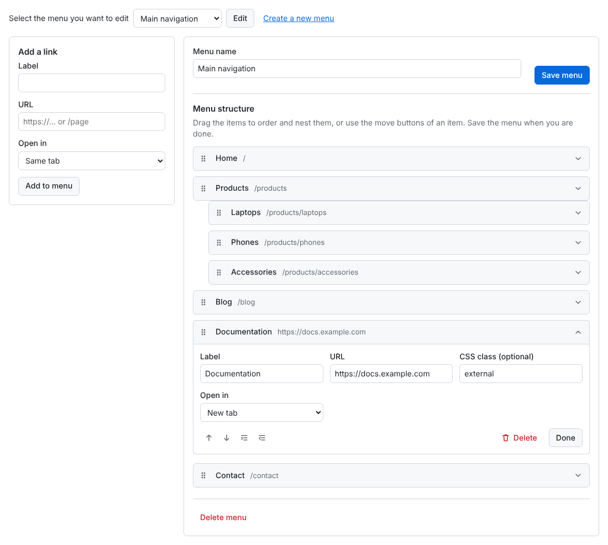

# Laravel Drag and Drop menu editor like wordpress
[](https://packagist.org/packages/harimayco/laravel-menu) [](https://packagist.org/packages/harimayco/laravel-menu) [](https://packagist.org/packages/harimayco/laravel-menu) [](https://packagist.org/packages/harimayco/laravel-menu)

forked from https://github.com/lordmacu/wmenu


### Installation

1. Run

```php
composer require harimayco/laravel-menu
```

**_Step 2 & 3 are optional, Laravel discovers the package automatically_**

2. Add the following class, to "providers" array in the file config/app.php (optional on laravel 5.5)

```php
Harimayco\Menu\MenuServiceProvider::class,
```

3. add facade in the file config/app.php (optional on laravel 5.5)

```php
'Menu' => Harimayco\Menu\Facades\Menu::class,
```

4. Run publish

```php
php artisan vendor:publish --provider="Harimayco\Menu\MenuServiceProvider"
```

5. Configure (optional) in **_config/menu.php_** :

- **_CUSTOM MIDDLEWARE:_** The builder routes use `['web', 'auth']` by default. Keep `web` (session + CSRF protection) and an authentication/authorization middleware (e.g. `['web', 'auth', 'can:manage-menus']`), otherwise anyone can edit your menus
- **_TABLE PREFIX:_** By default this package will create 2 new tables named "menus" and "menu_items" but you can still add your own table prefix avoiding conflict with existing table
- **_TABLE NAMES_** If you want use specific name of tables you have to modify that and the migrations
- **_Custom routes_** If you want to edit the route path you can edit the field
- **_Role Access_** If you want to enable roles (permissions) on menu items

6. Run migrate

```php
php artisan migrate
```

DONE

### Menu Builder Usage Example - displays the builder

On your view blade file

```php
@extends('app')

@section('contents')
    {!! Menu::render() !!}
@endsection

@push('scripts')
    {!! Menu::scripts() !!}
@endpush
```

The builder does not need jQuery: it ships its own script (with [SortableJS](https://github.com/SortableJS/Sortable)) and stylesheet,
published with the `public` tag. Items can be ordered and nested by drag and drop, or with the move buttons of each item (keyboard friendly).

### Using The Model

Call the model class

```php
use Harimayco\Menu\Models\Menus;
use Harimayco\Menu\Models\MenuItems;

```

### Menu Usage Example (a)

A basic two-level menu can be displayed in your blade template

##### Using Model Class
```php

/* get menu by id*/
$menu = Menus::find(1);
/* or by name */
$menu = Menus::where('name','Test Menu')->first();

/* or get menu by name and the items with EAGER LOADING (RECOMENDED for better performance and less query call)*/
$menu = Menus::where('name','Test Menu')->with('items')->first();
/*or by id */
$menu = Menus::where('id', 1)->with('items')->first();

//you can access by model result
$public_menu = $menu->items;

//or you can convert it to array
$public_menu = $menu->items->toArray();

```

##### or Using helper
```php
// Using Helper 
$public_menu = Menu::getByName('Public'); //return array

```

### Menu Usage Example (b)

The easiest way to show a menu is the Blade component:

```blade
<nav class="mainnav">
    <x-wmenu-menu name="Public" class="menu" />
</nav>
```

It renders nested `<ul>` lists (sub lists get the `sub-menu` class), adds the item CSS class, `target="_blank" rel="noopener noreferrer"`
for items opening in a new tab, and the `active` class on the item of the current page and its parents. Options:

| Attribute | Default | |
|---|---|---|
| `name` / `:id` | | the menu, by name or id |
| `active-class` | `active` | class of the current item and its parents |
| `submenu-class` | `sub-menu` | class of the nested lists |
| `:role` | | with `use_roles`, only show the items of this role and the ones for everyone |

Any other attribute (`class`, `id`, ...) goes on the outer `<ul>`. To change the markup, publish the views and edit
`resources/views/vendor/wmenu/components/menu-items.blade.php`.

Or build the markup yourself from the helper array:

```blade
@if($public_menu)
<ul class="menu">
    @foreach($public_menu as $menu)
    <li>
        <a href="{{ $menu['link'] }}" @if(($menu['target'] ?? null) === '_blank') target="_blank" rel="noopener noreferrer" @endif>{{ $menu['label'] }}</a>
        @if($menu['child'])
        <ul class="sub-menu">
            @foreach($menu['child'] as $child)
            <li><a href="{{ $child['link'] }}">{{ $child['label'] }}</a></li>
            @endforeach
        </ul>
        @endif
    </li>
    @endforeach
</ul>
@endif
```

### HELPERS

### Get Menu Items By Menu ID

```php
use Harimayco\Menu\Facades\Menu;
...
/*
Parameter: Menu ID
Return: Array
*/
$menuList = Menu::get(1);
```

### Get Menu Items By Menu Name

In this example, you must have a menu named _Admin_

```php
use Harimayco\Menu\Facades\Menu;
...
/*
Parameter: Menu ID
Return: Array
*/
$menuList = Menu::getByName('Admin');
```

### Access control

The builder routes use the `middleware` set in `config/menu.php` (`['web', 'auth']` by default).
To only let some users edit menus, define a Gate ability and set its name as `gate`:

```php
// app/Providers/AppServiceProvider.php
Gate::define('manage-menus', fn ($user) => $user->is_admin);
```

```php
// config/menu.php
'gate' => 'manage-menus',
```

### Cache

`Menu::get()` and `Menu::getByName()` can cache the menu tree. Enable it in `config/menu.php`:

```php
'cache' => [
    'enabled' => true,
    'store' => null, // default cache store
    'ttl' => 3600,
],
```

The cached tree of a menu is cleared whenever the menu or one of its items is saved or deleted through the models
(the builder always does). Clear the cache yourself after changing the tables with raw queries.

### JSON endpoints

The builder talks to these routes (prefixed with `route_path`, protected by the configured middleware). They return JSON
and `422` with the validation errors on invalid input.

| Method | URI | Route name | Body |
|---|---|---|---|
| POST | `menus` | `wmenu.menus.store` | `name` |
| PUT | `menus/{menu}` | `wmenu.menus.update` | `name`, `items[]` (`id`, `parent`, `sort`, and optionally `label`, `link`, `class`, `target`, `role_id`) |
| DELETE | `menus/{menu}` | `wmenu.menus.destroy` | `409` while the menu has items |
| POST | `menus/{menu}/items` | `wmenu.items.store` | `label`, `link`, `class`, `target` (`_blank` or empty), `role_id` |
| PUT | `menus/{menu}/items/{item}` | `wmenu.items.update` | `label`, `link`, `class`, `target` (`_blank` or empty), `role_id` |
| DELETE | `menus/{menu}/items/{item}` | `wmenu.items.destroy` | sub items move one level up |

Links must be relative (`/about`, `#top`) or use `http`, `https`, `mailto` or `tel`. Item depths are computed from the parents.
The old `h*` routes (`hcreatenewmenu`, `hgeneratemenucontrol`, ...) still work for builder scripts published before 2.0 but are deprecated.

### Customization

- **Look:** the builder styles are scoped to `.wmenu` and use CSS variables, override them in your admin stylesheet:

  ```css
  .wmenu { --wmenu-accent: #7c3aed; --wmenu-radius: 4px; --wmenu-font: inherit; }
  ```

- **Markup:** publish the views (`--tag=view`) and edit `resources/views/vendor/wmenu/`.
- **Texts:** the builder is translated in English and Vietnamese (`vi`), following `app()->getLocale()`.
  Publish the translations (`--tag=lang`) to change them or add a language in `lang/vendor/wmenu/{locale}/`.

### Development

```bash
composer install
composer test
```

Static analysis (needs Laravel 11+ dependencies):

```bash
composer require --dev larastan/larastan:^3.0
vendor/bin/phpstan analyse
```

### Credits

- [wmenu](https://github.com/lordmacu/wmenu) laravel package menu like wordpress

### Compatibility

- PHP 8.0+, Laravel 8.x, 9.x, 10.x, 11.x, 12.x
- For Laravel 5.x – 7.x use an older release of this package

### Upgrading from 1.x

- The default `middleware` in `config/menu.php` is now `['web', 'auth']`. If you published the config before, check that your `middleware` setting contains `web` and an authentication middleware: the old default `[]` left the builder routes open to everyone.
- The builder has a new interface without jQuery or the WordPress scripts. Re-publish the assets, and the views if you published them before:
  `php artisan vendor:publish --provider="Harimayco\Menu\MenuServiceProvider" --tag=public --force` (and `--tag=view --force`).
  The old files in `public/vendor/harimayco-menu` (`scripts.js`, `scripts2.js`, `menu.js`, `style.css`, `images/`) can be deleted.
- New `target` column (open in a new tab): publish the migrations and run `php artisan migrate`. Until then the builder keeps working without it.
- The role migration was previously published to `database/` instead of `database/migrations/` (and with an invalid timestamp). If you use roles and never ran it, publish the migrations again and run `php artisan migrate`; you can delete the old `database/2019_01_05_293551_add-role-id-to-menu-items-table.php` file.
- Menu item links are validated: they must be relative (`/about`, `#top`) or use `http`, `https`, `mailto` or `tel`. Links such as `javascript:` are rejected.
- Deleting an item moves its sub items one level up (as the builder UI shows) instead of leaving them pointing to a missing parent.
- The builder scripts use the new `wmenu.*` JSON routes. The old routes are deprecated.
- `Menu::render()` passes `$menu` (with its nested `items`) to the view instead of `$menus`/`$indmenu`.
- `$menu->items` now eager loads every level of sub items (`child` is recursive), not only the first one.
- The controller no longer extends `App\Http\Controllers\Controller`.

### KNOWN ISSUES
- None known. The builder now supports RTL pages ([#21](https://github.com/harimayco/wmenu-builder/issues/21)).
